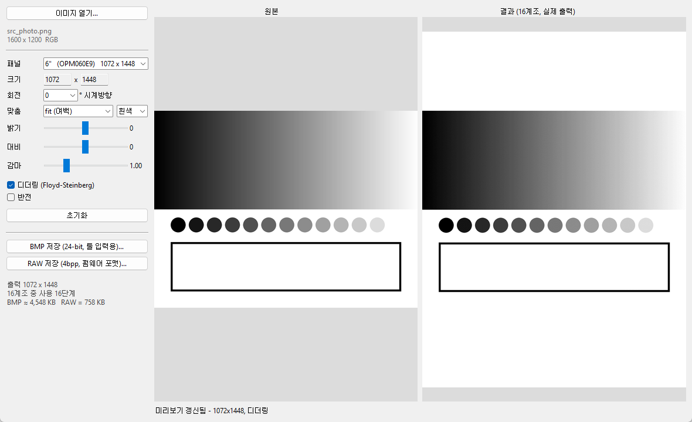

# EPD Image Resizer

사진을 e-paper 패널 크기로 맞추고 **16계조 그레이**로 변환하는 GUI 툴.
펌웨어와 무관하게 단독으로 동작합니다.



## 실행

```bash
pip install -r requirements.txt     # Pillow 하나 (Tkinter는 Python 기본 포함)
python epd_image_tool.py
```

이미지 열기 → 패널 선택 → 회전/맞춤/밝기/대비/감마/디더링 조절 → 오른쪽 미리보기(실제 16계조 결과) 확인 → 저장.

## 패널 프리셋

| 패널 | 비트맵 (W × H) | 비고 |
|---|---|---|
| 6"  (OPM060E9)  | 1072 × 1448 | 세로형 — 가로 사진은 회전 90° |
| 7.8" (ED078KC2) | 1872 × 1404 | |
| 10.3" (ED103TC2) | 1872 × 1404 | |
| 사용자 정의 | 임의 (가로는 짝수) | |

## 맞춤 모드

| 모드 | 동작 |
|---|---|
| fit (여백) | 전체가 들어가게 축소/**확대**, 남는 쪽 여백 |
| fill (잘라냄) | 패널을 꽉 덮게 채우고 넘치는 부분 잘라냄 |
| 가로 (width) | 가로를 정확히 맞춤 (세로는 잘리거나 여백) |
| 세로 (height) | 세로를 정확히 맞춤 |
| stretch (늘림) | 패널 크기로 왜곡 |
| 수동 (줌/드래그) | 줌 슬라이더 + **결과 미리보기 드래그로 위치 이동** (더블클릭=가운데) |

작은 이미지(예: 161×161)도 fit/width/height/fill 에서 자동으로 확대됩니다.
줌을 돌리거나 결과를 드래그하면 자동으로 "수동" 모드로 전환됩니다.

## 출력

| 파일 | 형식 | 용도 |
|---|---|---|
| `.bmp` | 24-bit, R=G=B, 값 0,17,…,255 (16단계) | EPDdemo / EPDctrl 등 PC 툴 입력 |
| `.bin` | 4bpp packed, 1바이트에 2픽셀, **첫 픽셀이 상위 니블**, 0=검정 … 15=흰색 | IT8951 이미지 버퍼에 들어가는 바이트열 그대로 |

## 명령행 / 배치

```bash
python epd_image_tool.py --cli photo.jpg --panel 6 --rotate 90 --out photo.bmp --raw photo.bin
python epd_image_tool.py --cli photo.jpg --size 800x600 --fit fill --no-dither --out x.bmp
python epd_image_tool.py --selftest        # 프리셋별 크기·레벨·raw 길이·BMP 왕복 검증
```

옵션: `--panel 6|7.8|10.3`, `--size WxH`, `--rotate 0|90|180|270`, `--fit fit|fill|stretch`,
`--pad-black`, `--brightness`, `--contrast`, `--gamma`, `--no-dither`, `--invert`

## 변환 파이프라인

회전 → 맞춤(fit/fill/stretch) → 그레이 → 밝기·대비·감마 → 16계조 양자화(Floyd-Steinberg 디더링 선택) → 반전(선택)

디더링을 켜면 e-paper에서 계조 띠(banding)가 눈에 띄게 줄어듭니다. 선·텍스트 위주 이미지는 끄는 편이 깔끔합니다.

## 보드로 전송

**GUI 안에서 바로 전송** — 변환된 결과를 저장 없이 보드로 보냅니다.
좌하단 "보드 IP"에 주소를 넣고 "▶ 보드로 전송". IP는 다음 실행 때 기억됩니다.
(모든 인치 지원: 미리보기 크기 그대로 전송)

### 명령행 (epd_send.py)

EPDdemo 는 6"(1448×1072) 전용이라 7.8"/10.3" 이미지는 못 보냅니다.
크기 무관 송신기를 함께 둡니다 — 레거시와 같은 10바이트 프로토콜.

```bash
python epd_send.py image.bmp --ip 192.168.45.154          # BMP는 패널 크기여야 함
python epd_send.py image.bin --ip 192.168.45.154 --w 1872 --h 1404
python epd_send.py image.bmp --ip 192.168.45.154 --no-clear
python epd_send.py --selftest
```

전송 순서: fill(흰색) → display → load(이미지) → display.
보드 IP 는 부팅 로그의 `connected, IP ...` 또는 시리얼 CLI 의 `wifi` 명령으로 확인.
